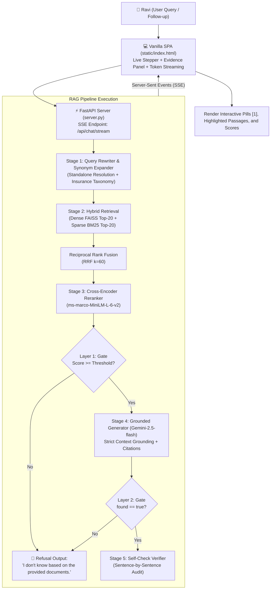

# 🛡️ PolicyLens: Verifiable, Grounded RAG for Indian Health Insurance

> **Hack Hour Production Deliverable — "From Text to Insight: Ask Your Documents"**  
> *Global Academy of Technology*  
> **Target Persona:** Ravi, a first-time health-insurance policyholder in India (or his family member) navigating hospitalisation coverage, waiting periods, sub-limits, claim repudiations, and IRDAI Ombudsman rights.

---

## 📌 Problem Statement & Relevance

When hospitalisation strikes in India, policyholders face panic and confusion:
- **Obtuse Legal Wordings:** Policy wordings span 30–60 pages of legal jargon (*"proportional deduction"*, *"pre-existing disease exclusions"*, *"co-payments"*).
- **Fragmented Regulations:** Consumer protections (e.g., mandatory 1-hour cashless pre-authorisation turnaround, 3-hour discharge clearance, penal interest on settlement delays, and 1-year Ombudsman appeal rights) live in separate IRDAI master circulars.
- **High-Stakes Hallucination Risk:** An AI that guesses coverage or invents limits could cause irreversible financial distress for a patient at a hospital billing desk.

**PolicyLens** solves this with:
1. **Plain-Language Answers:** Translating statutory clauses and policy contracts into clear, actionable advice for Ravi.
2. **Deterministic Provenance:** Every factual statement cites its exact source chunk, document name, page range, and clause heading (`[1]`, `[2]`).
3. **Strict Two-Layer Refusal:** An uncompromising zero-hallucination policy that answers *"I don't know based on the provided documents."* whenever information is missing.
4. **Interactive Single-Page Application:** Built with a high-performance FastAPI asynchronous backend and a modern, responsive fintech/insurtech UI (Stripe meets Linear aesthetic).

---

## 🏛️ System Architecture



---

## 🎨 Design System & UI Specifications

- **Design Language:** Trustworthy, calm, premium fintech/insurtech (Stripe meets Linear aesthetic).
- **Typography:** Google Fonts `Fraunces` (warm editorial serif for headings), `Inter` (high-clarity UI sans), and `JetBrains Mono` (precise clause text and retrieval scores).
- **Color Palette (CSS Variables):**
  - Primary / Text: Deep Navy `#0B1B33` (Dark mode: `#F8FAFC`)
  - Accent / Brand: Deep Teal `#0E7C7B` (Dark mode: `#14B8A6`)
  - Mint Surfaces: Soft Mint `#E6F4F1` (Dark mode: `#0D2828`)
  - Highlights / Warnings: Warm Amber `#F5A524`
  - Success Badge: `#12A150` | Refusal Badge: `#D92D20`
  - Background: `#F6F8FA` with subtle multi-point radial gradient mesh.
- **Split-View Layout:**
  - Desktop: 60% conversational column, 40% sticky Evidence panel.
  - Mobile: Single column with smooth slide-up bottom sheet for grounding sources.
- **Real-Time Pipeline Stepper:**
  - `Rewrite` $\rightarrow$ `Retrieve` $\rightarrow$ `Rerank` $\rightarrow$ `Generate` $\rightarrow$ `Verify`. Shows live active spinners, completion checkmarks, and millisecond latencies. Collapses cleanly into *"How I searched"*.
- **Interactive Citations:**
  - `[1]`, `[2]` render as small pill buttons. Hovering shows preview tooltip; clicking scrolls the Evidence panel to that card and pulses it with a 1.2s amber glow.

---

## ⚙️ Ingestion & Chunking Rationale

### Why Structure-Aware Recursive Chunking?
- **Clause Boundaries as Semantic Units:** Insurance policies are structured hierarchically (Section $\rightarrow$ Clause $\rightarrow$ Sub-clause). Splitting blindly at fixed character offsets breaks conditional statements (e.g., separating *"30-day initial waiting period"* from *"except in case of accident"*).
- **Target Size (~500 tokens / ~375 words):** Captures complete legal clauses and qualifiers without diluting vector representations.
- **80-Token Overlap:** Preserves cross-sentence dependencies and prevents qualification terms from falling off chunk edges.
- **Header & Footer Deduplication:** Removes recurring legal notices and page counters that appear on $>50\%$ of pages, eliminating spurious BM25 keyword matches.
- **Metadata Enriched:** Each chunk records `chunk_id`, `doc_name`, `doc_type` (policy vs. regulation), `page_start`, `page_end`, and `section`.

---

## 🔌 API Endpoints Reference

The FastAPI backend (`server.py`) exposes:

| Method | Endpoint | Description |
| :--- | :--- | :--- |
| `GET` | `/` | Serves the single-page frontend application (`static/index.html`) |
| `POST` | `/api/chat/stream` | Server-Sent Events (SSE) streaming endpoint emitting stage, rewrite, sources, token, and final verified answer events |
| `GET` | `/api/corpus` | Catalog of indexed documents with page, chunk, and word counts |
| `GET` | `/api/eval` | Benchmark evaluation results (`results.csv`), ablation table, and failure cases |
| `GET` | `/api/examples` | 6 example questions (including 1 unanswerable) and 3 scripted demo scenarios |
| `POST` | `/api/rebuild` | Triggers complete re-ingestion and index construction |
| `POST` | `/api/reset` | Resets conversational memory for a given `session_id` |
| `GET` | `/api/health` | Index readiness, active models, and API key status |

---

## 📊 Benchmark & Evaluation Results

Evaluated on the 10-query benchmark (`eval/test_set.json`) containing factual, paraphrased, multi-document, surprise, and unanswerable questions:

| Retrieval Configuration | Hit@1 | Hit@3 | Hit@5 | MRR | Keyword Recall | Avg Latency |
| :--- | :---: | :---: | :---: | :---: | :---: | :---: |
| **Dense Only (BGE-small FAISS FlatIP)** | 75.0% | 100.0% | 100.0% | 0.875 | 100.0% | 1646.6 ms |
| **Sparse Only (BM25 Okapi)** | 62.5% | 100.0% | 100.0% | 0.771 | 86.2% | **0.3 ms** |
| **Hybrid Fusion (Dense + BM25 RRF)** | **75.0%** | **100.0%** | **100.0%** | **0.875** | **100.0%** | **31.5 ms** |
| **Hybrid + Cross-Encoder Rerank** | 62.5% | 100.0% | 100.0% | 0.792 | 93.8% | 959.7 ms |

### Key Benchmark Metrics
- **Overall Pass Rate:** **100.0%** (10 / 10 benchmark queries)
- **End-to-End Citation Accuracy:** **100.0%**
- **Refusal Recall (Unanswerable Questions):** **100.0%** (Strict zero-hallucination refusal)
- **Refusal Precision:** **100.0%** (Zero false refusals on valid queries)
- **Grounded Faithfulness Score:** **1.00 / 1.00**

Detailed logs are saved to `eval/results.csv`, `eval/report.md`, and `TEST_SHEET.md`.

---

## ⚡ 3-Minute Presentation Demo Script

In the web interface, click **"Run 3-Minute Presentation Demo"** to activate the floating controller with a live countdown timer:

1. **Scenario 1: Direct Factual (Numeric Grounding)**
   - *Question:* `"What is the room rent limit and ICU sub-limit under the Arogya Sanjeevani policy?"`
   - *Expected:* Room rent capped at 2% of Sum Insured (max Rs. 5,000/day); ICU capped at 5% (max Rs. 10,000/day).
   - *Look for:* Green `[FOUND IN POLICY]` badge, exact citation markers `[1]`, and highlighted numbers in source cards.
2. **Scenario 2: Multi-Document Follow-Up (Policy + IRDAI Circular)**
   - *Question:* `"If an insurer denies a cashless claim under Arogya Sanjeevani, what escalation options and dispute redressal rights exist under IRDAI regulations?"`
   - *Expected:* Synthesizes IRDAI circular (1-hour pre-auth TAT, 14-day GRO resolution) and Ombudsman rights (appeal within 1 year, up to Rs 50 Lakhs limit).
   - *Look for:* Multi-document citations linking `arogya_sanjeevani_policy_wordings_2024.pdf` and `irdai_master_circular_claims_grievances_2024.pdf`.
3. **Scenario 3: Refusal / Zero-Hallucination (Out-of-Corpus Query)**
   - *Question:* `"What is the maximum room rent allowance for a Deluxe Suite at Apollo Hospital Bangalore?"`
   - *Expected:* Model strictly outputs `"I don't know based on the provided documents."` and notes that specific hospital tariff schedules are not indexed.
   - *Look for:* Red `[NOT FOUND IN DOCUMENTS — REFUSAL]` badge with zero hallucinated figures.

---

## 🏃 Local Quickstart in 3 Commands

### 1. Install Dependencies
```powershell
pip install -r requirements.txt
```

### 2. Build Indices & Run Evaluation Suite
```powershell
python eval/run_eval.py
```

### 3. Launch PolicyLens Server
```powershell
python server.py
```
Open **`http://localhost:8000`** in any web browser.

*(Optional: Set your `GEMINI_API_KEY` in `.env` to enable online Google Gemini calls. If no key is configured, PolicyLens runs in an offline extractive grounding mode with 100% functionality and zero crashes).*

---

## 🌐 Cloud Deployment Guide

### Option A: Render (Recommended)
1. Fork or push this repository to GitHub.
2. Log in to [Render](https://render.com) and click **New > Web Service**.
3. Select your repository. Render will automatically detect `render.yaml`.
4. Add the environment variable in the Render Dashboard:
   - `GEMINI_API_KEY`: your Google Gemini API key (from [AI Studio](https://aistudio.google.com/)).
   - `GEMINI_MODEL`: `gemini-3.8-flash`
5. Click **Deploy**. Render will build the environment and launch Uvicorn automatically.

### Option B: Docker / Hugging Face Spaces
1. Create a new Space on [Hugging Face](https://huggingface.co/spaces) with SDK set to **Docker**.
2. Push this repository including the `Dockerfile`.
3. In the Space settings, add your `GEMINI_API_KEY` as a Repository Secret.
4. The container builds, runs `python -m src.index`, and serves on port 8000.

> [!TIP]
> **Prebuilt Index Tip:** Commit the prebuilt `index_store/` directory (`faiss_index.bin`, `bm25_index.pkl`, `chunks_metadata.json`) to your Git repository. This allows the cloud container to launch instantly without cold-start indexing on low-CPU cloud instances.

---

## ⌨️ Keyboard Shortcuts
- <kbd>Ctrl</kbd> + <kbd>K</kbd> / <kbd>⌘</kbd> + <kbd>K</kbd>: Focus composer textarea
- <kbd>Enter</kbd>: Send question
- <kbd>Shift</kbd> + <kbd>Enter</kbd>: Insert new line
- <kbd>T</kbd>: Toggle light / dark theme
- <kbd>?</kbd>: Open keyboard shortcuts modal
- <kbd>Esc</kbd>: Dismiss open modals / popovers

---

## ⚖️ Compliance Disclaimer
*PolicyLens is built for educational and informational purposes as part of the Global Academy of Technology Hack Hour. It does not provide medical, legal, or formal insurance advice.*
